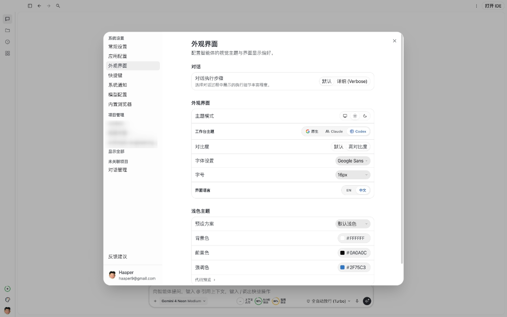
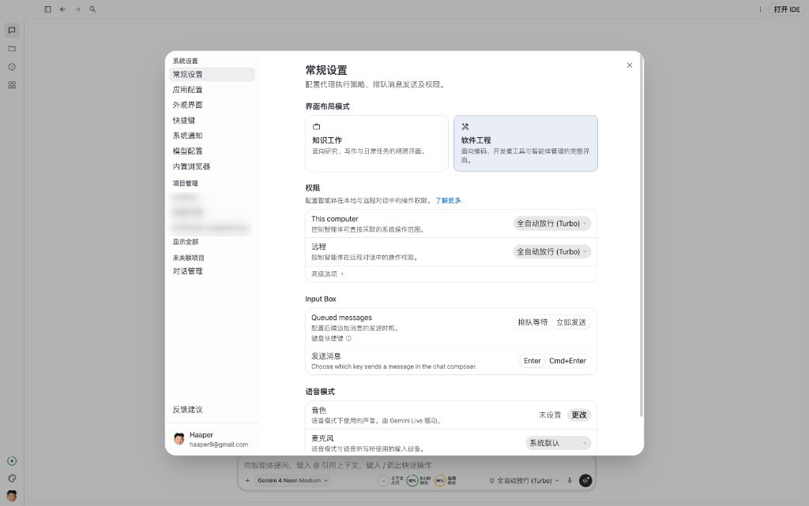
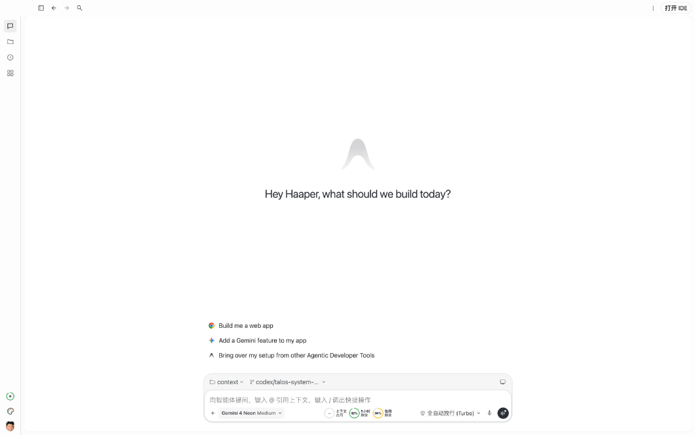
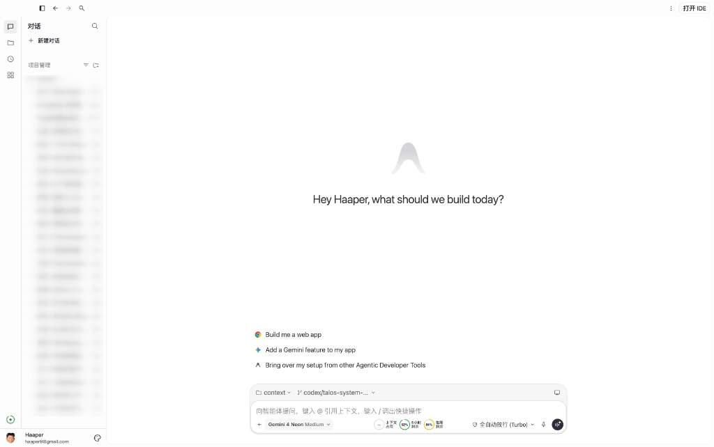
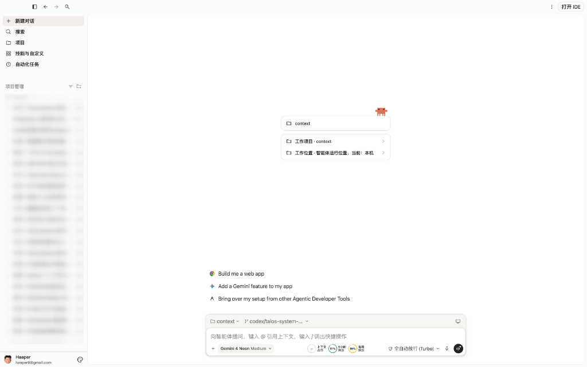

# TALOS Antigravity 桌面工作台（`talos-antigravity-workbench`）

> 由 **TALOS System** 维护的非官方、无侵入 **Google Antigravity 桌面端**增强启动器（macOS）。  
> **不修改原版 `/Applications/Antigravity.app`**，不破坏官方签名与自动更新，安装时在本地自动生成轻量启动器并复用原版图标。

---

## 核心特性

1. **简体中文 / 英文免重启实时切换**
   - 覆盖主菜单、设置面板、侧边栏、动态状态与提示，智能避让代码块、终端、用户输入与文件路径。
   - 在 **系统设置 → 外观界面** 底部提供原生风格 **`EN` | `中文`** 切换胶囊，点击即时生效并自动记忆。
2. **三套工作台主题与布局（支持浅色 / 深色）**
   - 内置 **Google 原生**、**Claude 风格**、**Codex 风格** 三套视觉主题及工作台侧栏布局。
   - 可在 **系统设置 → 外观界面 → 工作台主题**、侧栏底部账号区或统计卡标题栏随时切换，偏好自动持久化。
3. **上下文与额度三环实时统计**
   - 输入框底部集成 **上下文占用 / 5 小时剩余 / 每周剩余** 三枚小圆环，点击展开重置倒计时与轮次明细。
4. **新对话自动中文规范命名**
   - 仅处理新发起且主题明确的对话，保留手动重命名的标题，不改动历史对话数据库。

---

## 界面预览

- **外观界面（原生 / Claude / Codex 主题 + `EN` / `中文` 实时切换）**

  

- **常规设置（中文化设置面板）**

  

- **专注模式工作台（底部上下文与额度三环统计）**

  

- **展开侧栏的工作台主界面**

  

- **Claude 风格工作台主题**

  

---

## 环境要求

- **操作系统**：macOS（已验证 Apple Silicon + Google Antigravity `2.34.0`）
- **原版应用**：已安装官方 `/Applications/Antigravity.app`
- **运行时**：Node.js `v22.5+`（需内置 `node:sqlite` 支持；安装器如检测到 `clang` 会编译原生轻量启动器，未安装 Xcode CLT 时自动降级为轻量 Shell 启动入口）

---

## 快速安装

```bash
git clone https://github.com/Hanhan758/talos-antigravity-workbench.git
cd talos-antigravity-workbench
chmod +x scripts/install.sh scripts/uninstall.sh
./scripts/install.sh
```

安装完成后：
1. 完全退出当前正在运行的 Antigravity；
2. 打开 `~/Applications/Antigravity 中文.app`（已自动复用原版图标，可直接拖入 Dock 替代原图标）；
3. 打开 **系统设置 → 外观界面**，即可使用「工作台主题」与「界面语言」切换。

### 常用参数

```bash
# 仅检查环境与将执行的操作（不写入文件）
./scripts/install.sh --dry-run

# 自定义原版应用路径或输出路径
./scripts/install.sh --app "/Applications/Antigravity.app" --dest "$HOME/Applications/Antigravity 中文.app"

# 卸载启动器（不影响原版 Antigravity）
./scripts/uninstall.sh

# 卸载并一并清理缓存与主题/语言偏好
./scripts/uninstall.sh --purge-cache --purge-prefs
```

---

## 工作原理与安全边界

- **无侵入**：通过 Electron 匿名调试管道（`--remote-debugging-pipe`）仅向本机 `https://127.0.0.1:<port>` 的 Antigravity 主窗口注入前端样式与脚本，不开启对外端口，不修改原版 `app.asar`。
- **防 macOS「文稿」反复授权弹窗**：
  - **动静分离（固定启动器 CDHash）**：运行时 JS/CSS 独立部署在 `~/Library/Application Support/talos-antigravity-workbench/runtime/`，启动器 `.app` 仅保留轻量外壳与原版图标；后续运行 `install.sh` 更新主题或汉化时不会重签 `.app`，避免 macOS TCC 因签名哈希变化而反复弹窗。如需彻底绑定证书身份，也支持 `--sign "<本机证书名>"`。
  - **受限沙盒额度查询**：后台额度查询在 `sandbox-exec`（`quota-only.sb`）中运行，明确禁止读取 `Documents`、`Desktop`、`Downloads` 且禁止拉起外部 MCP 进程，并在退出时按进程组回收。
- **原版签名校验**：启动器拉起前会使用 `codesign --verify --strict` 校验原版应用包签名。
- **零数据上传**：所有汉化、主题与统计均在本地完成，不上传对话内容、账号信息或令牌。
- **随时回退**：若官方大改版导致某项样式失效，直接打开 `/Applications/Antigravity.app` 即可无损回到原版。

---

## 许可与声明

- 本项目源码采用 [MIT License](LICENSE) 开源；主题选择器中的品牌识别图标遵循 [BRAND-ICONS-LICENSE](BRAND-ICONS-LICENSE)。
- 本项目与 Google、Anthropic、OpenAI 无官方关联；原版图标仅在用户本机安装时从用户已安装的 Antigravity 中动态复用，不随仓库分发。
